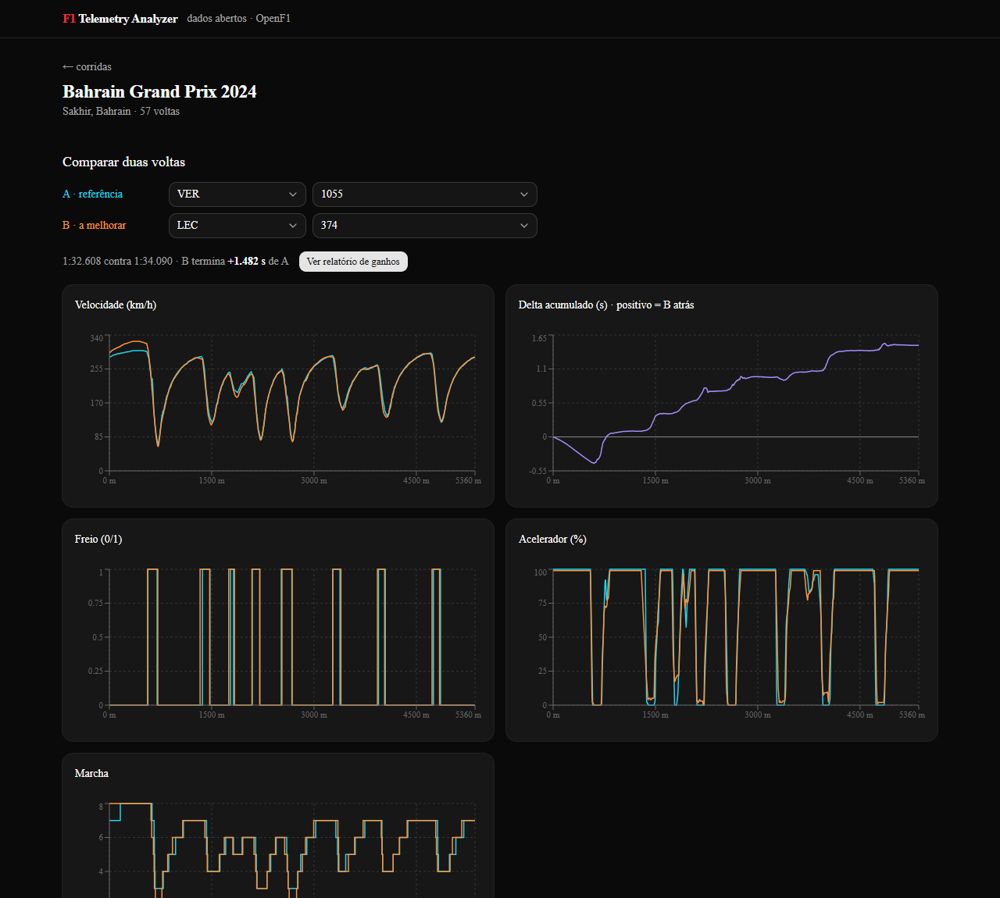
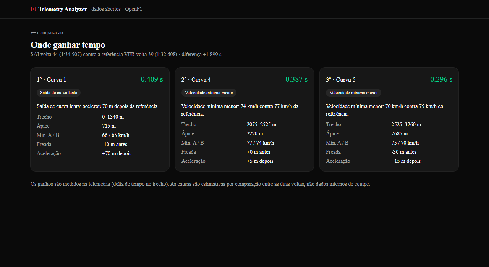
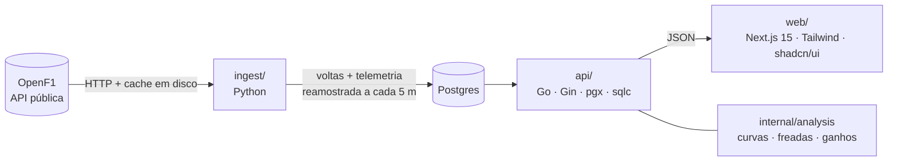

# F1 Telemetry Analyzer

Ingere a telemetria de **todas as voltas de uma corrida de Fórmula 1**, compara duas voltas lado a lado por distância percorrida e gera um relatório automático com os **3 maiores pontos de ganho de tempo** (qual curva, quanto tempo e por quê).

**Demo online:** DEMO_URL




> As sugestões são uma análise comparativa entre pilotos e voltas, a partir de dados públicos de telemetria. Não são engenharia de carro: não há dados internos de equipe.

## O que faz

1. **Ingestão** de uma corrida completa (todas as voltas, todos os pilotos): velocidade, rotação, marcha, acelerador, freio, posição, tempos de setor, pneu e posição na volta.
2. **Comparação** de duas voltas: gráficos sobrepostos de velocidade, freio, acelerador e marcha, mais o delta de tempo acumulado.
3. **Relatório** das 3 curvas onde a volta B mais perde tempo para a referência A, com o motivo: frenagem antecipada, velocidade mínima menor ou saída de curva lenta.
4. Extras: consistência por piloto (desvio padrão das voltas limpas) e degradação de pneu por stint.

## Arquitetura



| Pasta | Papel |
| --- | --- |
| `ingest/` | Baixa a sessão no OpenF1, integra a velocidade em distância, reamostra cada volta numa grade de 5 m e grava no Postgres. |
| `api/` | Endpoints de corridas, pilotos, voltas, comparação e relatório. Migrações com golang-migrate embutidas no binário; consultas geradas com sqlc. |
| `api/internal/analysis` | Código puro (sem I/O) que detecta zonas de frenagem e curvas e explica cada perda de tempo. |
| `web/` | Seleção de corrida e voltas, gráficos (Recharts) e página do relatório. |

### Endpoints

| Rota | Retorno |
| --- | --- |
| `GET /api/races` | corridas ingeridas |
| `GET /api/races/:id/drivers` | pilotos, melhor volta, voltas limpas, consistência (σ) |
| `GET /api/races/:id/laps` | todas as voltas com pneu, posição e flags |
| `GET /api/races/:id/degradation` | stints com inclinação do tempo de volta pela idade do pneu |
| `GET /api/compare?a=<volta>&b=<volta>` | telemetria alinhada por distância das duas voltas + delta |
| `GET /api/report?a=<volta>&b=<volta>` | 3 maiores ganhos da volta B em relação à A |

## Como rodar localmente

Requisitos: Docker. Para desenvolver sem Docker: Go 1.27, Python 3.12, Node 22 e um Postgres.

```bash
docker compose up -d --build                     # Postgres, API (aplica as migrações) e web
make ingest YEAR=2024 ROUND=1                    # qualquer corrida de 2023 em diante, um comando
```

Abra http://localhost:3000. O `make ingest` equivale a `docker compose --profile ingest run --rm ingest --year 2024 --round 1`; as respostas do OpenF1 ficam em cache, então repetir é rápido. No Windows sem `make`, rode o comando do `docker compose` direto.

Sem Docker:

```bash
pip install --requirement ingest/requirements.txt
export DATABASE_URL=postgres://f1:f1@localhost:5432/f1
(cd api && go run ./cmd/server)                  # aplica as migrações
python -m ingest --year 2024 --round 1
(cd web && npm install && npm run dev)
```

Variáveis em `.env.example`. Testes: `make test` (Go e Python); o front passa por `npm run lint` e `npm run build`. Tudo isso roda no GitHub Actions (`.github/workflows/ci.yml`).

## Como a análise funciona

- **Distância:** o OpenF1 não tem odômetro, então a distância é a integral da velocidade. Ela deriva alguns metros entre voltas, por isso cada volta é reescalada para o mesmo comprimento de pista (a mediana da corrida) antes de ir para a grade de 5 m.
- **Delta:** tempo acumulado de B menos A em cada ponto da grade.
- **Curvas:** mínimos locais da velocidade suavizada, com proeminência de pelo menos 15 km/h e 100 m entre si. Cada curva vai do pico de velocidade anterior ao seguinte.
- **Ganho:** é medido (delta no fim do trecho menos delta no início). Os 3 maiores viram o relatório.
- **Causa:** é estimada. Cada hipótese vira segundos: metros extras de frenagem a essa velocidade, velocidade mínima menor ao longo da zona da curva, ou metros até voltar ao acelerador. A maior vence; se nenhuma passa do limiar, o relatório diz que a perda é distribuída.
- **Volta limpa:** não é a primeira, sem box, e com tempo até 107% da mediana do piloto (tira safety car e tráfego pesado).

## Decisões técnicas

- **OpenF1 em vez de FastF1.** O plano era FastF1, mas a versão atual (3.9) exige login numa conta Formula 1 para baixar os dados. O OpenF1 é aberto, sem chave, e permite o "um comando" sem credenciais.
- **Telemetria normalizada em arrays no Postgres.** Uma linha por volta com arrays `real[]` (≈1 000 pontos) em vez de uma linha por amostra: ~1 100 linhas por corrida, leitura de uma volta em uma consulta, sem particionamento. A telemetria bruta não é guardada; ela continua no cache em disco do ingest.
- **Reingestão idempotente.** Rodar a mesma corrida de novo apaga e recria a corrida em uma transação.
- **Análise em Go, pura e testada.** Fica fora dos handlers, recebe vetores e devolve structs, e é coberta por testes com voltas sintéticas.
- **Migrações no binário da API.** O mesmo SQL serve ao Docker, ao desenvolvimento local e ao deploy.

## Limitações conhecidas

- **Resolução:** o OpenF1 amostra a ~3,7 Hz (um carro anda 15 a 20 m entre amostras). Pontos de frenagem e de aceleração têm incerteza dessa ordem, por isso diferenças menores que 20 m são ignoradas.
- **Dados:** o OpenF1 cobre de 2023 em diante. Voltas sem amostras completas (abandonos) ficam sem telemetria.
- **Curvas sem nome:** as curvas são numeradas na ordem da volta, não pelos números oficiais do circuito. A primeira e a última curva incluem parte da reta de largada.
- **Degradação de pneu:** é a inclinação bruta do tempo de volta pela idade do pneu; inclui o ganho por combustível queimado, então valores perto de zero ou negativos são normais.
- **Causa estimada:** o motivo de cada perda é uma heurística comparativa, não uma medição. Voltas com tráfego diferente podem gerar explicações enganosas.
- **Fora do escopo:** previsão de estratégia com machine learning, dados em tempo real e contas de usuário.

## Dados

Os dados vêm do [OpenF1](https://openf1.org); este projeto não é afiliado à Formula 1 nem à FIA.
